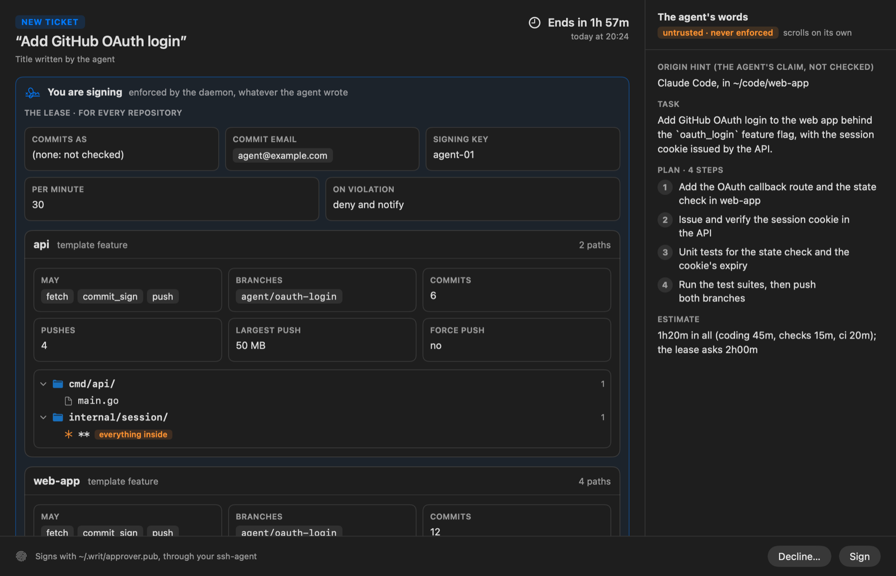

# Writ

**Let your AI agents commit and push on their own, without ever giving them your keys.**

An agent drafts a **ticket** for its task: which repositories, which branches, what it may do,
for how long. You read it and sign it once. The signed ticket (the *writ*) becomes a scoped,
time-boxed **lease**, and the agent works through the whole task while you're away: its
commits signed and shown as verified on your remote, its pushes checked one by one, and
nothing outside what you signed.

> *A writ is a written order, issued under seal, that authorizes someone to act within stated
> limits.*



<sub>The approval popup on the Mac, with made-up data. Left: what you sign, every term enforced
by the daemon. Right: the agent's own words, shown as written and never trusted.</sub>

## Why

An agent working for an hour stalls on its first commit if every signature asks for your
Touch ID. Handing it a key that never asks is worse: any process can then sign or push
anything, anywhere. Writ sits in between. **You approve the task, not each commit**, and the
daemon holds the agent to it.

## How it works

```
  agent                       writd (the daemon)                     your remote
  ─────                       ──────────────────                     ───────────
  1. drafts a ticket ───────► checks it against your templates
                              2. you read it and sign it (Touch ID) ─► it becomes a lease
  3. git commit ────────────► signs the commit with a key the agent never sees
  4. git push ──────────────► checks every commit and ref against the lease ──► pushes upstream
                              5. the lease ends: time, a close, or your revoke
```

- **The agent asks, you decide.** A ticket names repositories, branches, operations
  (`fetch`, `commit_sign`, `push`), the paths it expects to touch, a time limit, and how many
  commits and pushes. Refuse it with a reason, and the agent revises its plan. Narrow it before
  you sign. Need more mid-task? The agent asks for an amendment.
- **Templates cap every ticket.** You write them once with `writ admin template add`: no
  ticket can ask for more than its template allows, whatever the agent writes.
- **The daemon is the agent's git remote.** It holds the signing keys and the remote
  credentials, checks every push against the lease (branches, protected refs, force pushes,
  the commits it signed, the paths they touch, size), and is the only thing that pushes
  upstream.
- **Everything is logged; every lease is revocable at once.**

## What you get

- 🔑 **Agents never hold a key.** No signing key, no token, no deploy key on the agent's side.
  It can't leak what it never had.
- ✅ **Verified commits.** Commits are signed with SSH or OpenPGP keys you register on your
  account, and show as verified on GitHub, Codeberg, Forgejo or Gitea.
- 👀 **You see what you sign.** `writ sign` in the terminal, or the popup on the Mac: every
  enforced term on one side, the agent's words on the other, terminal tricks neutralized.
- 🖐️ **One approval per task, with your own key.** Approvals are SSH signatures from a
  dedicated key in your ssh-agent (Secretive and its Touch ID on the Mac). A click is never
  an approval.
- 🔒 **Fail closed.** No matching lease, a sealed daemon, unreadable input, any error: denied,
  with the reason.
- 🍏 **Hardware where there is some.** On the Mac, keys can live in the Secure Enclave; the
  keystore is sealed at rest and unsealed with your approval.
- 🌍 **Any remote.** Plain git over SSH or HTTPS: GitHub, Codeberg, Forgejo, Gitea, GitLab…
- 🤖 **Any agent.** A skill tells the agent how to ask for a lease: Claude Code, Codex and
  other `AGENTS.md` agents, opencode, Cursor.

## Quick start

On a Mac or a Linux workstation, from this repository:

```sh
make install                      # the daemon under its own user, the clients, the popup
writ unseal                       # after the install and after each restart
writ admin template add feature   # the most a ticket may ask for
writ admin repo add myrepo        # a repository, its remote and its templates
cd ~/code/myrepo && writ init myrepo --agents claude   # route its git through Writ
claude                            # give it a task: it asks for a ticket, you sign it
```

Starting the agent under Writ, as `writ run -- claude`, is optional: it binds the lease to that
agent alone and revokes it when the agent quits (required by a template with
`require_session: true`).

The [quick start](docs/operators/quick-start.md) walks through each step, keys included, up to
an agent's first verified commit.

## Status

**Version 1.0.0**: v1 is complete and in daily use, in local mode on macOS and Linux (the daemon
on the machine the agents run on, under a user of its own). What could come next, detached mode
in Docker and hardware-held session keys among it, is in the [backlog](docs/backlog/README.md).

Writ is built for one operator: you, your agents, your repositories.

## Documentation

- [Running Writ](docs/operators/README.md): install, quick start, daily operations, every
  configuration key, good practice beside an agent.
- [Threat model](docs/threat-model.md): what Writ guarantees, the tests that try to break each
  guarantee, and what it doesn't protect against.
- [Documentation index](docs/README.md): the product, the architecture, the decisions.
- [Changelog](CHANGELOG.md): what changed in each release, and what an upgrade asks.
- [Working on this repo](AGENTS.md), for humans and agents.

## License

[Apache License 2.0](LICENSE).
