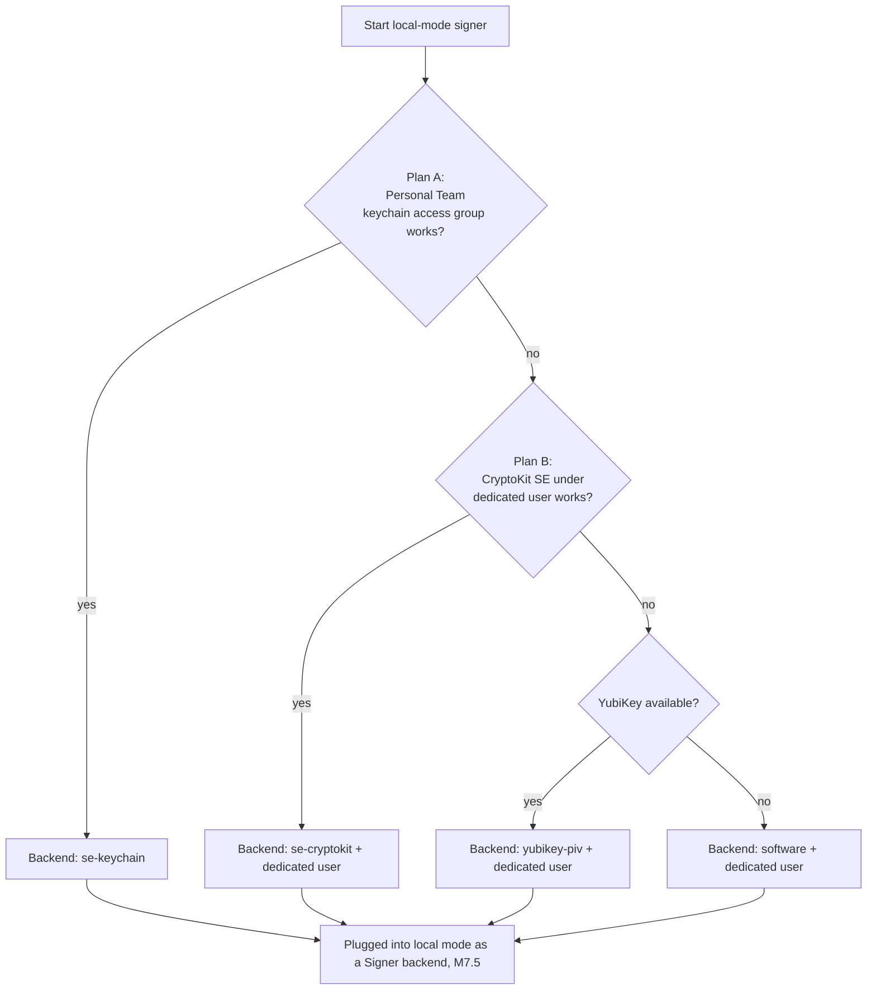

# macOS Secure Enclave signer without a paid Apple Developer account

Status: **tested in the [M0 spike](../history/m0-protocol-spike.md) on 2026-10-31.
Plan B is the local-mode signer**: a CryptoKit Secure Enclave key under a dedicated `_writd`
user, built in [M7.5](../history/m7.5-secure-enclave-signer.md) (`se-cryptokit`, through the
`writ-se` helper: [signer](signer.md#a-helper-process)); the `_writd`
LaunchDaemon is set up in [M7](../history/m7-local-mode-on-the-mac.md). Plan A works but
doesn't isolate the key from my user; Plan D wasn't needed. Every check and number is in
[the M0 spike's results](../history/m0-protocol-spike.md#secure-enclave-results);
the summary is in [M0 results](#m0-results) below. Every option is a `Signer` implementation
([Signer and sealing](signer.md), [Platform interfaces](platform.md)).

## Goal

In local mode, `writd` should hold agent keys that are:

1. **non-exportable**: generated in the Secure Enclave
2. **usable without a prompt**: agents work unattended, including with the screen locked
3. **usable only by the daemon**: not by other processes running as my user (agents included)

This document covers what we can do without the Apple Developer Program, and the fallbacks if those options don't work. The paid route (a keychain access group) was meant to meet all three, but under the dedicated `_writd` user it brings nothing Plan B lacks, and a launchd daemon can't use the data protection keychain anyway: it is [parked](../backlog/parked/keychain-secure-enclave-signer.md).

## Background: why a self-signed certificate isn't enough

macOS has two separate mechanisms, and they don't use code signing the same way:

| Mechanism | Checks | Works with a self-signed certificate? |
|---|---|---|
| TCC permissions, ACLs in the legacy file-based keychain | The app's *designated requirement* (derived from its signing certificate) | ✅ Yes. That's the trick used for Omega Code: stable identity across builds |
| Keychain access groups (data protection keychain) | The `keychain-access-groups` entitlement | ❌ No. It's a **restricted** entitlement that needs an Apple-issued provisioning profile. Without one, the binary is killed at launch; without the entitlement, keychain calls fail with `errSecMissingEntitlement` (-34018) |

Secure Enclave keys can only be persisted in the **data protection keychain**, so the legacy keychain's ACLs can't help here.

## Options, in order of preference

### Plan A: Xcode free "Personal Team" + keychain access group ❌ (tested: no isolation from my user)

A free Apple ID gives an Apple Development certificate and development provisioning profiles. If they cover the keychain sharing capability for macOS, we get the same design as the paid route, for free, on this Mac only.

**Setup**
- Xcode → Settings → Accounts → add Apple ID → Personal Team
- Create a macOS app target `writd` (the daemon must be an app bundle to embed a profile)
- Add the *Keychain Sharing* capability with group `$(AppIdentifierPrefix)dev.writ.daemon`
- Create the key with `SecKeyCreateRandomKey`:
  - `kSecAttrTokenID = kSecAttrTokenIDSecureEnclave`
  - `kSecAttrIsPermanent = true`
  - `kSecAttrAccessGroup = <TEAMID>.dev.writ.daemon`
  - `kSecUseDataProtectionKeychain = true`
  - access control: `kSecAttrAccessibleAfterFirstUnlockThisDeviceOnly` + `.privateKeyUsage` only (no `.userPresence` / `.biometryAny`)

**Tests**
- [ ] Capability accepted for a Personal Team on macOS
- [ ] App launches with the profile embedded (not killed)
- [ ] Key creation and signing succeed, with no prompt
- [ ] Signing still works after reboot + login, and with the **screen locked**
- [ ] Signing works when launched as a LaunchAgent / via `SMAppService`
- [ ] A different binary (self-signed, other identity) **cannot** find or use the key (`SecItemCopyMatching` → not found)
- [ ] Profile expiry date: `security cms -D -i writd.app/Contents/embedded.provisionprofile` → `ExpirationDate`
- [ ] After re-signing with a renewed profile, the existing key is still usable (Team ID unchanged)

**Pass:** all checked. **Risks:** short-lived development profiles mean periodic rebuilds; if the app stops launching when the profile expires, agents are blocked until I rebuild (fail closed, but annoying).

### Plan B: CryptoKit Secure Enclave key + dedicated macOS user ✅ (tested, chosen)

CryptoKit (`SecureEnclave.P256.Signing.PrivateKey`) creates Secure Enclave keys **without any entitlement** (`age-plugin-se` ships as a plain CLI using it). It returns an encrypted blob (`dataRepresentation`) that only this Mac's Secure Enclave can use, but which isn't tied to an app: any process that can read the blob can probably use it on this Mac.

So we replace the access group with a **Unix permission boundary**: the daemon runs as its own user, and the blob lives in that user's home.

**Setup**
- Create a dedicated user, either:
  - a role account (`_writd`, UID < 500, no login shell), or
  - a hidden standard user, if the role account can't use the Secure Enclave (see tests)
- Run `writd` as a LaunchDaemon with `UserName = _writd`
- Blob directory owned by `_writd`, mode `0700`; blob file `0600`
- Key access control: `.privateKeyUsage` only; accessibility `AfterFirstUnlockThisDeviceOnly`
- Socket for agents in a directory my user can reach (group permission), so agents talk to the daemon but can't read its files
- Sign the binary with the self-signed certificate + hardened runtime anyway (stable identity, no debugger attach)

**Tests**
- [ ] Key creation succeeds when running as `_writd` from a LaunchDaemon
- [ ] Signing works after reboot, **before** I log in, and after I log in
- [ ] Signing works with my screen locked
- [ ] My user cannot read the blob (`cat` → permission denied)
- [ ] My user cannot attach to the daemon process (`lldb -p` → denied)
- [ ] Copying the blob to another Mac and loading it fails (bound to this Secure Enclave)

**Main uncertainty:** Secure Enclave keys are tied to a user's keybag. A role account that never logs in may not have an unlocked keybag, so key use could fail. If so, try the hidden standard user and check whether one login after boot is required.

**Pass:** creation + signing work unattended under the dedicated user. **Trade-off:** root can read the blob, but only to use it on this Mac; root is out of scope in the threat model.

### Plan C: CryptoKit blob under my own user (testing only)

Same as Plan B, but without the dedicated user. The key stays non-exportable, but **any process running as me, agents included, could use it** and bypass Writ.

Use only to develop and test the signer backend. Not acceptable for real use.

### Plan D: no Secure Enclave in local mode

If neither A nor B works:

- **YubiKey PIV backend**
  - Key generated on the YubiKey, touch policy `never`, PIN policy `once`
  - The PIN is stored only in the daemon's keystore, so other processes can open the card but can't sign without it ⚠️ (verify PIN caching per PC/SC session)
  - Combine with Plan B's dedicated user for the keystore
- **Software signer** under the dedicated user (Plan B's isolation without the Secure Enclave)
  - Keys in the encrypted, sealed keystore, readable only by `_writd`
  - Exportable by root, otherwise isolated from my user

### Plan E: detached mode (no Apple dependency)

`writd` in Docker on the homelab server with the software signer. Nothing here depends on Apple signing, and approvals already go through Secretive, which is signed.

Neither mode waits on the Secure Enclave: local mode ships first (M7) with the software signer and a daemon isolated from my user, and the Secure Enclave backend plugs in afterwards (M7.5) as one more `Signer`: Plan B, `se-cryptokit`, which the M0 spike chose.

## Decision flow

## M0 results

Measured on an M1 Pro, macOS 27.2, FileVault on; details in
[the M0 spike's results](../history/m0-protocol-spike.md#secure-enclave-results).

- **Plan A** works mechanically: a Personal Team may use keychain access groups on macOS,
  the key is created and signs with no prompt (6–7 ms); code without the entitlement is
  refused, an ad-hoc binary claiming it is killed. But **other code, reusing the profile and
  signed with my Apple Development identity, used the key with no prompt**: the group binds
  the key to my team, and anything running as my user can sign with my team (identity in the
  login keychain, Xcode's account session). Development builds also allow debugger attach,
  and the profile lasts 7 days. The paid-account version is
  [parked](../backlog/parked/keychain-secure-enclave-signer.md): under `_writd` it adds
  nothing to Plan B, and a launchd daemon can't use the data protection keychain.
- **Plan B** passes: a role account `_writd` (uid below 500, no shell, hidden) creates the
  key from a LaunchDaemon and signs with no prompt (8–44 ms), with the screen locked, after a
  reboot and while nobody is logged in. My user can't read the blob, use it, attach to the
  daemon, signal it, or replace its binary or LaunchDaemon.
- Not run: copying the blob to another Mac (no second Mac available).
- **Found later, on the first real install (2026-11-14): a signing key must be made where it
  is used.** A key made by `sudo -u _writd writd init`, run from my logged-in session, is
  made and signs a probe there, and its blob opens under the LaunchDaemon, but the Secure
  Enclave refuses every signature there (`sign-failed`, CryptoKit's error not passed on); a
  key the running daemon made signs. The spike made and used each key from the
  LaunchDaemon, so it never met this. Since then a key on a device is made only by `writd
  run` ([signer](signer.md#keys-on-the-secure-enclave-in-the-daemon)), and each one signs a
  probe at unseal. The keystore's key-agreement key, made the same way by `writd init`,
  unwraps under the LaunchDaemon all the same: why the two differ is an
  [open question](../decisions.md#open-questions) (Q41).

Notes for M7 and M7.5:
- **With FileVault on, there is no "before login" state:** nothing on the data volume runs
  until the first login after a boot unlocks the disk. The daemon starts then, and keeps
  signing after I log out.
- **The Mac must stay awake:** with the lid closed it sleeps and the daemon pauses (true of
  the agents too).
- **A corrupted blob crashes the process** inside CryptoKit instead of throwing (its own
  `try!`, `SEP_P256.swift`): the backend must guard against it (check the blob, or load it
  where a crash can't take the daemon down).
- **And it can crash the Mac** (found in M7.5, 2026-11-12): many corrupted blobs sent in a
  row made the Secure Enclave's firmware panic (`SEP Panic: :sks`), which panics the kernel.
  So M7.5's backend never hands the Secure Enclave a blob it didn't make for that key: each
  blob is kept framed with a digest over the key's public point, checked before use
  ([signer](signer.md#a-helper-process)), and no test sends one a malformed blob
  ([testing](../testing.md#hardened-tests)).
- The first signatures after a boot take 170–420 ms, then 15–45 ms.

## Summary

| Plan | Cost | Non-exportable | Only the daemon | Works with screen locked | Maintenance |
|---|---|---|---|---|---|
| Paid account + access group ([parked](../backlog/parked/keychain-secure-enclave-signer.md)) | 99 €/yr | ✅ | ⚠️ team-wide in my session; under `_writd` the daemon probably can't use the keychain (TN3137) | ✅ | Low |
| A: Personal Team + access group (tested) | Free | ✅ | ❌ team-wide: any code I can sign with my team | ✅ | Rebuild every 7 days |
| B: CryptoKit + dedicated user (tested, chosen) | Free | ✅ | ✅ (Unix permissions) | ✅ | Medium (user + LaunchDaemon setup) |
| C: CryptoKit, own user | Free | ✅ | ❌ | ✅ | Testing only |
| D: YubiKey PIV + dedicated user | Hardware I already own | ✅ | ✅ (PIN held by daemon) ⚠️ | ✅ | Low |
| D: software + dedicated user | Free | ❌ (root) | ✅ (Unix permissions) | ✅ | Low |
| E: detached mode | Free | Depends on server backend | ✅ (other host) | ✅ | Server upkeep |

## Signer backends this maps to

All plans plug into the existing `Signer` interface. One verb is added first: M5's
`Signer::add_key` takes a key made outside the backend, which the Secure Enclave can't take
(it makes its own keys), so M7.5 adds the verb for that (e.g. `create_key(id, algorithm)`,
the daemon keeping the blob it returns), or merges both into one, with its contract tests,
before the backend ([signer](signer.md#signer-interface), decision log 2026-11-03):

| Backend id | Used by |
|---|---|
| `se-keychain` | Plan A (not built; the paid version is [parked](../backlog/parked/keychain-secure-enclave-signer.md)) |
| `se-cryptokit` | Plans B and C |
| `yubikey-piv` | Plan D |
| `software` | Plan D, Plan E |

Switching plans changes only the configured backend, not the daemon.

**The keystore's hardware recipient (M7.6)** is the same Secure Enclave through the same
helper, with a key of another kind: a `SecureEnclave.P256.KeyAgreement` key (no prompt, the
same access control), whose ECDH unwraps the `piv-p256` stanzas the keystore's tokens and
identity are wrapped to ([hardware-wrapped secrets](../history/m7.6-hardware-wrapped-secrets.md)).
Its blob is framed under its own header, so a signing key's blob never reaches CryptoKit as an
agreement key's, nor the other way round; it lives under `_writd` like every other blob.

## What doesn't work (don't retry)

- Self-signed certificate claiming `keychain-access-groups`: killed at launch (restricted entitlement, no profile)
- Data protection keychain without the entitlement: `errSecMissingEntitlement` (-34018)
- Legacy file-based keychain with ACLs: can't hold Secure Enclave keys
- CryptoKit blob alone as an isolation mechanism: it's bound to the Mac, not to the app (confirmed in M0)
- Personal Team keychain access group as isolation from my user: any code signed with my team can use the key, and anything running as my user can sign with my team (M0)
- Data protection keychain from a launchd daemon (paid account or not): only available in a user login context, per Apple's [TN3137](https://developer.apple.com/documentation/technotes/tn3137-on-mac-keychains); not tested by us, see the [parked page](../backlog/parked/keychain-secure-enclave-signer.md)
