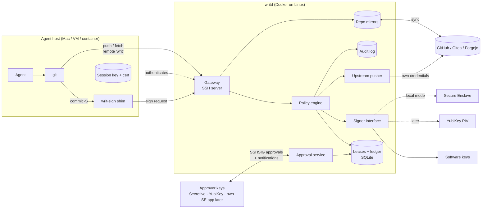

# Architecture overview

## Deployment modes

The same daemon (`writd`) and the same client protocol run in two modes:

| | **Detached** | **Local** |
|---|---|---|
| Where | Linux server (Docker), e.g. homelab | My Mac, native |
| Agents | Anywhere: Mac, VMs, containers, other hosts | Agents on that Mac |
| Signer backend | Software (v1) → YubiKey / TPM later | Secure Enclave (or any backend) |
| Approvals | SSHSIG from registered approver keys (Secretive first) | Same |
| Caller identity | Session key + daemon-issued SSH certificate | Same, **plus** kernel peer checks (process tree) on the Unix socket |

Clients never need to know which mode they talk to. The difference is only the endpoint and,
in local mode, extra checks ([Identity](identity.md#local-mode-process-chain-checks)).

A mode is a **configuration, not a code path**: the core is platform-agnostic, and everything
that differs (transport, caller facts, session watching, signer backend, unseal, notifications)
is an implementation of an interface plugged in at startup. See
[Platform interfaces](platform.md).

## Overview (detached mode)



## Components

| Component | What it does | Page |
|---|---|---|
| Gateway (SSH server) | Single entry point for agents: git fetch/push, `sign`, lease commands | [gateway.md](gateway.md) |
| Repo mirrors, upstream pusher, push modes | Serve fetches, quarantine pushes, push upstream with the daemon's credentials | [gateway.md](gateway.md#repo-mirrors) |
| Policy engine | Every request → the single matching lease → allow / deny + notify | [policy-and-state.md](policy-and-state.md) |
| Lease store + ledger | SQLite: leases, their state, every commit signed per lease | [policy-and-state.md](policy-and-state.md#lease-store--ledger-sqlite) |
| Audit log | Append-only JSONL of every event | [policy-and-state.md](policy-and-state.md#audit-log) |
| Signer interface | Where agent keys and upstream credentials live, and how they sign | [signer.md](signer.md) |
| Startup and sealing | Encrypted keystore, sealed start, `writ unseal` | [signer.md](signer.md#startup-and-sealing) |
| Approval service | Verifies approver SSHSIGs over tickets, admin changes and unseal requests | [approvals.md](approvals.md) |
| Session identity, process chain | Daemon-issued SSH certificates; kernel peer checks in local mode | [identity.md](identity.md) |
| Platform interfaces | `Transport`, `CallerAttestor`, `SessionWatcher`, `KeystoreUnlock`, `Notifier` (and `Signer`): what makes a mode a configuration | [platform.md](platform.md) |
| Clients | `writ` CLI, agent skill, `writ-sign`, `writ try`, harness | [clients.md](clients.md) |
| Deployment | Docker compose, network exposure, host hardening | [deployment.md](deployment.md) |

## Repository layout

One Cargo workspace. Each crate has a `README.md` saying what it does and what it doesn't;
the code conventions (module layout, errors, logging, tests) are in
[conventions.md](../conventions.md).

```
Cargo.toml              workspace root (members, shared lints, shared dependency versions)
rust-toolchain.toml
Makefile
crates/
  writ-core/            lease model: registry, templates, tickets, canonical encoding,
                        template fit, narrowing, lifecycle, caller facts, policy decisions,
                        text neutralization. Pure: no I/O.
  writ-proto/           messages between clients and the daemon (commands, replies, bodies)
  writ-crypto/          SSHSIG build/verify, the SSH CA (certificates), approvers file,
                        keys and randomness, the approval API's pinned TLS
  writ-platform/        platform traits (Transport, CallerAttestor, SessionWatcher,
                        KeystoreUnlock, Notifier, Clock), portable implementations, private
                        files, fakes and contract suites (feature `testing`)
  writ-store/           SQLite lease store + ledger, JSONL audit log
  writ-gateway/         russh server: git upload/receive-pack, sign, lease commands, the
                        approval API over SSH and HTTPS
  writ-approval/        the approval service: tickets, approvals, refusals, revocations,
                        the lease a certificate stands for (admin changes and unseal: M5)
  writd/                the daemon binary: config, keystore, wiring of the crates above
  writ-cli/             the `writ` binary
  writ-sign/            the `writ-sign` shim
  writ-integration/     test-only: the crates working together, through the binaries
tool/                   check scripts run by `make check`
dev/                    the development daemon's configuration
docs/
```

Planned, created by the milestone that needs them:

```
crates/
  writ-signer/          `Signer` trait + backends (M3)
  writ-git/             commit parsing, pack quarantine, mirrors, upstream push (M3, M4)
  writ-platform-macos/  macOS-only implementations (process chain, kqueue, Secure Enclave; M7)
  writ-platform-linux/  Linux-only implementations (later)
skill/writ/SKILL.md     the agent skill (M6)
deploy/                 Dockerfile, compose.yaml (M8)
spikes/                 throwaway spike code, outside the workspace, removed once done
```

### Dependency directions

- `writ-core` depends on nothing internal. It holds every decision that can be made without
  I/O, so the policy is testable as plain functions.
- **Clients never contain policy.** `writ-cli` and `writ-sign` may depend on `writ-core`
  (types, display, canonical encoding for signing), `writ-proto` and `writ-crypto` (keys,
  approval signatures, the pinned TLS), but never on `writ-store`, `writ-signer`,
  `writ-gateway`, `writ-approval`, `writ-platform*` or `writd`. A check they make
  is a convenience; the daemon checks again.
- Only `writ-signer` and the platform crates know key backends. Every other crate goes
  through the `Signer` trait.
- The core crates (`writ-core`, `writ-store`, `writ-git`, `writ-gateway`, `writ-approval`)
  depend on the platform **traits**, never on `writ-platform-macos` / `writ-platform-linux`.
  No `#[cfg(target_os)]` outside the platform crates and `writd/src/platform.rs`
  ([Platform interfaces](platform.md#rules)).
- Only `writd` wires crates together, picks the implementations and reads configuration.

These rules are checked by `make check`: `tool/check-deps.py` (dependency directions, over
`cargo metadata`) and `tool/check-rules.py` (no `#[cfg(target_os)]` outside the platform
crates, no print macros in library crates, no `mod.rs`).
