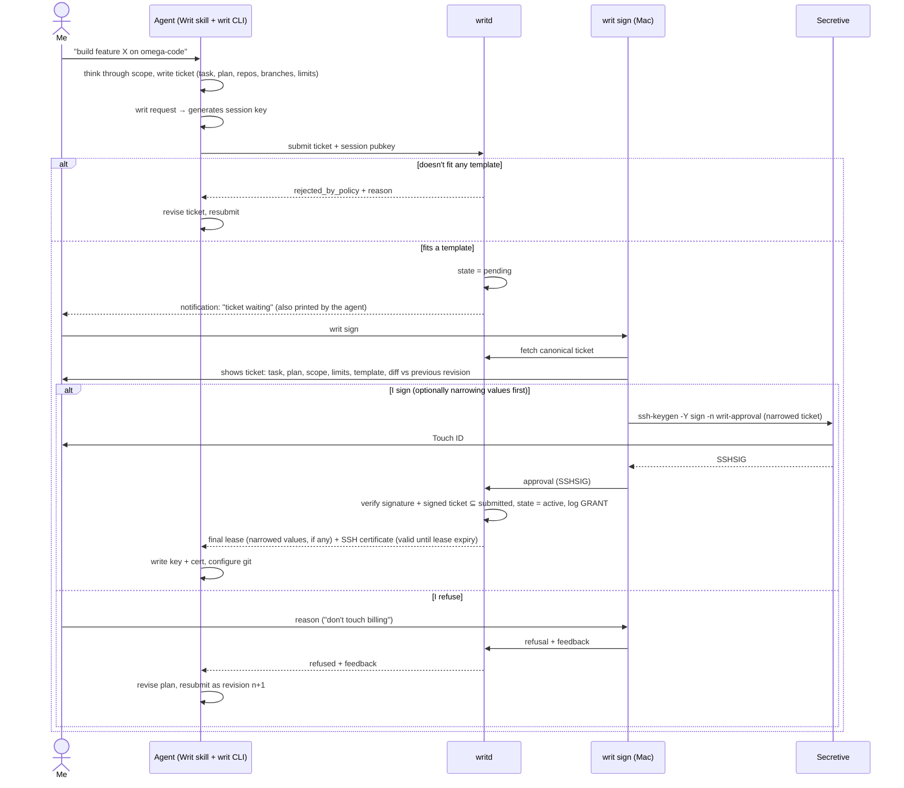
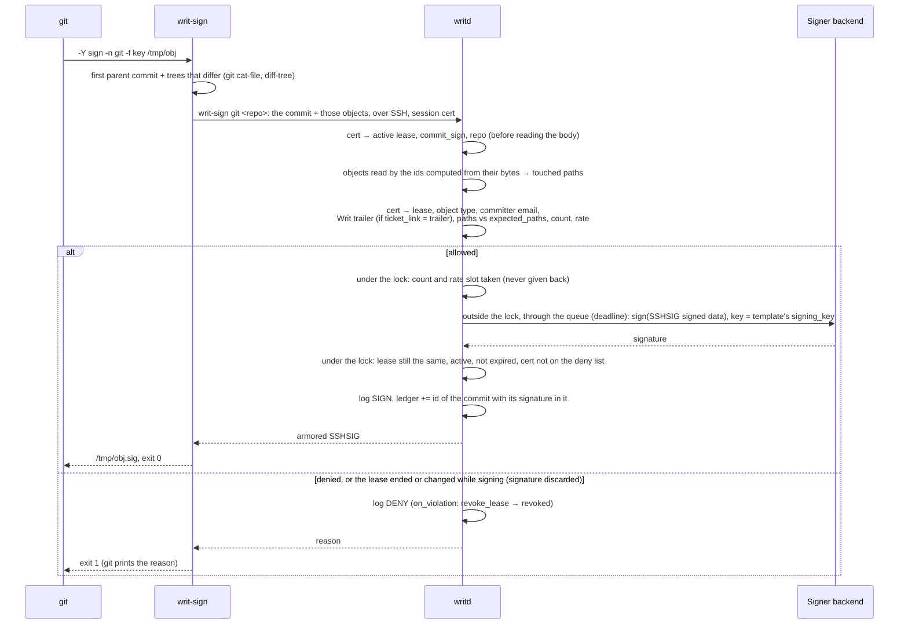
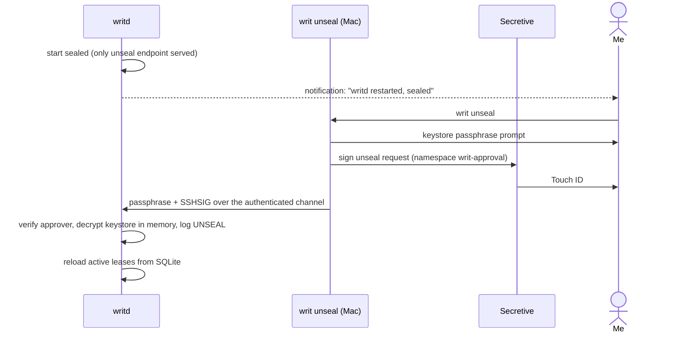

# Flows

All flows are the same in detached and local mode, except where noted. The objects they move
(tickets, leases, templates) are defined in [Lease model](lease-model.md); the components in
[Architecture overview](architecture/overview.md).

## 1. Ticket: submit, review, sign or refuse



When a harness (e.g. Omega Code) requests the lease on the agent's behalf, it plays the
`writ request` part and writes the key, certificate and git config itself.

On the wire (M2): `writ request` connects to the agents' listener as user `writ` with the new
session key and runs `writ request` (the ticket file on stdin); the key it authenticated with
becomes `subject.session_key`. It then runs `writ wait <id>` on the same connection, which
returns once I decide: the lease (canonical bytes) and the certificate, the feedback, or
`expired` / `revoked`. Only that session key can wait on the ticket. The session lands in
`~/.writ/sessions/<lease>/` (`key`, `key.pub`, `key-cert.pub`, `ticket.json`, `lease.json`,
and `signing_key.pub`, the daemon's key for the lease's commits),
with `current` pointing at it. `writ request` exits 0 when granted, 3 when rejected by
policy, 4 when refused, 5 when the ticket expired or was withdrawn. `writ sign` and
`writ refuse` reach the approval listener ([Approvals](architecture/approvals.md#reaching-the-daemon)).

## 2. Signed commit



The signer never runs under the service's state lock: a revocation, an approval or a `writ
wait` never waits for a device, and a lease revoked, expired or amended while its commit is
being signed gets no signature ([Policy and state](architecture/policy-and-state.md#policy-engine)).

Signing happens at **commit time** so commit hashes never change. The ledger links signing to
the later push: it records the id of the commit git writes once the signature is in it (git
puts it in a `gpgsig` header, `writ_git::signed`), so the same commit without its signature,
which has another id, never matches. Denial notifications come with M8.

## 3. Push

```mermaid
sequenceDiagram
  participant G as git (agent)
  participant D as writd gateway
  participant Q as Quarantine
  participant F as Remote (upstream)
  G->>D: git push writ agent/x (session cert)
  D->>D: lease covers push + repo (may_push), mirror synced unless fresh
  D->>Q: receive-pack: the pack, fsck'd, in quarantine
  Q->>D: pre-receive hook: token, quarantine, ref updates
  D->>D: lease again, mirror held, read from the objects git verified:<br/>new commits, fast-forwards, case twins, size, paths again
  D->>D: under one lock: ledger, decide_push (refs, protected refs, force push,<br/>every new commit signed under this lease with the same paths, size),<br/>count and rate, log PUSH
  alt accepted
    D->>D: lease once more
    D->>F: push --atomic --force-with-lease from the quarantine, daemon credential
    alt upstream ok
      D-->>Q: ok: git moves the mirror's refs
      D-->>G: ok
      opt ticket_link: notes
        D->>D: the commits wait for their note; once git gave the mirror back,<br/>the notes job: notes commit, merged into the notes ref
        D->>F: push the notes ref, fast-forward (moved: fetch, merge, once more)
        D->>D: log NOTES (allowed, or denied: the notes wait for the next push)
      end
    else upstream rejects (moved, its hook, an error)
      D->>D: log DENY with the remote's reason
      D-->>G: rejected + upstream reason (the mirror unchanged)
    end
  else denied
    D->>D: log DENY (on_violation applied)
    D-->>G: rejected + reason
  end
```

If upstream moved, the agent fetches through the daemon, rebases, and the new commits are
signed again under the same lease. The notes of a `ticket_link: notes` repo
([Notes](architecture/gateway.md#notes)) follow the branch on their own: a notes push that
fails never undoes the branch's. A push already decided keeps its slot of the lease's count
and rate when the remote refuses it.

### 3b. Push, `proxy` mode
The agent connects to the daemon (same URL rewrite).

1. The daemon reads `git-receive-pack '<path>'` and the ref update lines: checks repo, refs,
   protected refs and force push.
2. It buffers the pack into a temporary quarantine (bounded by `max_push_size`) and indexes it
   with `git index-pack`.
3. It walks the new commits and checks each one against the ledger for this lease.
4. Only then does it open its own SSH session to the remote and relay the ref updates and the
   pack.
5. The quarantine is deleted; the remote's answer goes back to the agent. Any rejection shows
   in the agent's terminal, as with `gateway`.

To find which commits are "new" without a mirror, the daemon first asks the remote for its
current refs (the advertisement at the start of the upstream session), relays them to the
agent, and uses them as the boundary.

The daemon advertises the `no-thin` capability to the agent, so the pack is self-contained: it
can be indexed and every commit object in it read without having the remote's objects locally.
Commits in the pack are exactly the new commits to check.

Notes (`ticket_link: notes`) go the same way as in `gateway` mode, from a small notes-only
repository per repo instead of the mirror: the notes job needs only the notes ref, never
the annotated commits.

### 3c. Push, `direct_ssh` mode
At lease grant, the daemon also exposes a per-lease ssh-agent socket (reachable through the
session channel) holding only the repo's deploy key. Each signature request is checked for
host (`session-bind`), user, limits and TTL. The remote enforces the repo; nothing enforces
refs.

## 4. Fetch

`git fetch writ` → `Service::fetch`: the certificate's single active lease, the policy's
`decide_fetch` (the lease allows `fetch` and names the repo, the rate) and one operation taken
from the rate window, under one lock, logged as one `fetch` line, so `max_ops_per_minute`
bounds fetches too (a fetch never uses up a lease). Then the daemon syncs its mirror from
upstream unless it is fresh (`mirrors.fresh_for`), outside the state lock, and serves
`upload-pack`; a sync that fails refuses the fetch with its reason (`cannot sync from
upstream: …`), logged. Requires a lease with `fetch` (or a read-only template). Agents never
hold remote credentials, even read-only ones.

## 5. Revoke / expire

- `writ revoke <id>`, menu bar, phone → lease `revoked`, certificate added to the deny list,
  open sessions dropped (the gateway disconnects every SSH session of that certificate). With
  `decisions: signed`, the revocation is an SSHSIG over a `writ-revocation/1` document. On a
  pending ticket, `writ revoke` withdraws it.
- TTL reached → `expired`; every counted operation used up → `exhausted` (never with
  `fetch`, [lease model](lease-model.md#lifecycle)); notify. The daemon checks every second
  and before every request; the certificate itself ends at `expires_at`, and open sessions
  are dropped like on a revocation. A pending ticket not signed by `expires_at` expires too.
- Local mode: session root process exits → `revoked`
- Violation with `on_violation: revoke_lease` → revoked + notify

## 6. Out-of-ticket request

**Deny + notify.** The operation fails immediately with a reason the agent can read, plus a
hint: *"outside ticket wrt_…: branch main not allowed. If needed, submit an amendment."*

If the agent genuinely needs more, the skill tells it to submit an **amendment**
(`amends: <id>`) explaining why. I sign or refuse it like any ticket. The denied operation is
not replayed; the agent retries after the amendment is signed.

## 6b. Closing a ticket

When the work is done, the agent runs `writ close` with a short summary. The daemon:
- ends the lease and revokes the certificate
- produces an **activity report**: commits signed, pushes, branches, denials, time used vs
  granted, files touched vs `expected_paths`

I review the report alongside the branch before merging.

## 7. Daemon startup: sealed



Until unsealed, every request fails closed with "daemon sealed". Later, hardware recipients
replace the passphrase.
