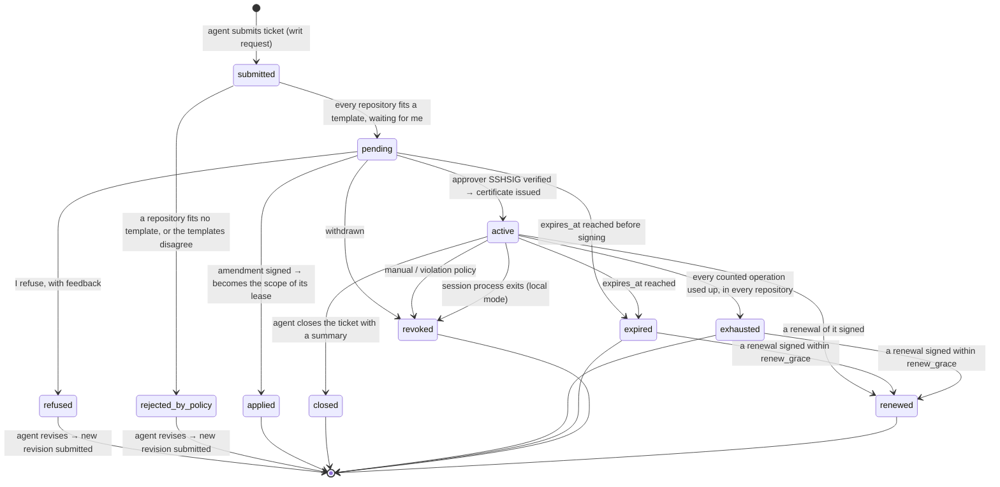

# Lease model

A **ticket** is the agent's request: the task, its plan, and the scope it needs. Once I sign
it with an approver key, it becomes a **lease**: a bounded right for that agent session to use
the daemon. One ticket = one feature or fix.

Three layers, from fixed to per-task:

| Layer | Written by | Changes |
|---|---|---|
| **Keys and host pins** | Me (admin approval) | Rarely. Every key the policy names, declared with its use; each `ssh://` upstream's host keys |
| **Repo registry** | Me (admin approval) | Rarely. Hard limits per repo: protected refs, upstream, the templates it allows |
| **Templates** | Me (admin approval) | Rarely. The maximum shape a ticket can take in a repo that names it |
| **Ticket** | The agent | Per task. Each repository's terms fit a template that allows it; I sign or refuse it |

The code for this page lives in `crates/writ-core` (types, template fit, narrowing, state
machine) and is enforced by the [policy engine](architecture/policy-and-state.md).
Every key of the registry, the templates and the ticket file, with its default, bound and
status: the operator reference ([`policy.yaml`](operators/policy-yaml.md),
[the ticket file](operators/ticket.md)).

## Keys and host pins (admin-approved)

```yaml
format: 2
keys:
  agent-ed25519-01: { use: signing, format: ssh, algorithm: ed25519 }
  upstream-github-01: { use: upstream, kind: ssh, algorithm: ed25519 }
  upstream-forgejo-01: { use: upstream, kind: ssh, algorithm: rsa4096 }   # some remotes take RSA only
  token-example-01: { use: upstream, kind: token, host: git.example.org }  # sent to that host only
  deploy-dotfiles-01: { use: upstream, kind: ssh, algorithm: ed25519 }
upstream_hosts:
  github.com: ["ssh-ed25519 AAAA…"]
  forgejo.home: ["ssh-ed25519 AAAA…"]
```

Every key a template or a repo names is declared here, for that use: a template signs only
with a `signing` key, a repo reaches upstream only with an `upstream` one of the kind its URL
takes (`ssh` for `ssh://`, a `token` declared for the URL's host for `https://`). The change
that declares a key makes it; nothing about a key is guessed. Each `ssh://` upstream's host
has its keys pinned in `upstream_hosts`: nothing is learned on first use.

## Repo registry (admin-approved)

```yaml
repos:
  omega-code:
    upstream: ssh://git@github.com/user/omega-code.git
    upstream_credential: upstream-github-01   # SSH key on my GitHub account (account-wide access)
    templates: [feature-branch, quick-fix]    # the templates its tickets may use; []: closed
    protected_refs: ["refs/heads/main", "refs/tags/*"]   # never pushable by any lease
    ticket_link: trailer                      # ledger_only (default) | trailer | notes
    object_format: sha1                       # sha1 (default) | sha256: commits signed only in it
  homelab-scripts:
    upstream: ssh://git@forgejo.home/user/homelab-scripts.git
    upstream_credential: upstream-forgejo-01
    templates: [feature-branch, quick-fix]
    protected_refs: ["refs/heads/main"]
  some-https-only-repo:
    upstream: https://git.example.org/user/some-repo.git   # https://[user@]host[:port]/path
    upstream_credential: token-example-01     # a token in the keystore (`writ admin token token-example-01`)
    templates: [quick-fix]
  dotfiles:
    upstream: ssh://git@github.com/user/dotfiles.git
    upstream_credential: deploy-dotfiles-01   # deploy key: the remote limits it to this repo
    templates: [quick-fix]
```

Defaults: `protected_refs: []`, `ticket_link: ledger_only` (many
projects' commit conventions don't allow an extra trailer),
`object_format: sha1` (GitHub and most remotes have only SHA-1 repositories; a commit is
signed only in its repo's format, so a SHA-256 repository never gets SHA-1 objects signed).
The `upstream` URL picks how the daemon reaches it: `ssh://` with a key in its signer,
`https://` with a token from its keystore (never `http://`, never a password in the URL)
([gateway](architecture/gateway.md#upstream)). `templates` names the templates whose
tickets may reach the repo; `[]` keeps it registered, with its mirror and credential, while
every ticket for it is refused as closed.
Repo names are unique ignoring case: a repo's mirror is `<name>.git`, and on a
case-insensitive file system (local mode's APFS) `Demo` and `demo` would be one directory.

Every push goes through the gateway: the daemon's mirror, then upstream
([gateway](architecture/gateway.md#push-checks-in-gits-quarantine)). The `proxy` and
`direct_ssh` push modes of format 1 were dropped in M7.9.6, never built
([parked](backlog/README.md#parked)).

Changing the registry is an admin change and needs a signed approval.

## Templates (admin-approved)

```yaml
templates:
  feature-branch:                          # no repos here: each repo names its templates
    operations: [fetch, commit_sign, push]
    branches: ["agent/*"]
    force_push: false                      # default false: tickets can't ask for it
    committer_emails: ["user+agent@example.org"]   # required with commit_sign
    committer_name: "Writ agent"           # optional: the name on every commit; unset, not checked
    signing_key: agent-ed25519-01          # required with commit_sign: the signer key for commits
    max_ttl: 4h
    max_signatures: 50
    max_pushes: 30
    max_ops_per_minute: 20
    max_push_size: 50MB
    paths_check: warn                      # off | warn | deny (default warn)
    require_expected_paths: false
    require_session: false                 # local mode: a ticket must be bound to a session (writ run)
  quick-fix:
    operations: [fetch, commit_sign, push]
    branches: ["agent/fix-*"]
    committer_emails: ["user+agent@example.org"]
    signing_key: agent-ed25519-01
    max_ttl: 1h
    max_signatures: 10
    max_pushes: 5
    max_ops_per_minute: 10
    max_push_size: 10MB
    paths_check: off                       # quick fixes rarely map to paths
```

Every limit is required, so a template never caps by accident. A template caps every part
of a ticket: repos, operations, branches, force push, committer emails, the signing key and
each limit. Its `committer_name`, when set, is not something a ticket asks for: the daemon
copies it into every lease that signs, and every commit's author and committer must carry
exactly that name (git's `user.name`, which `writ git` and a whole-repo clone set from the
lease). Unset, the name isn't checked. It doesn't make a remote show a commit as verified
(the email and the key do); it keeps an agent from signing as someone else by name.

A ticket with a repository that fits no template, or whose templates disagree (the signing
key, the committer name), is rejected by the daemon before it reaches me, with every reason
sent back to the agent. Config errors name the field
(`templates.quick-fix.max_ttl: invalid duration "1 hour"`).

### Patterns and units

- **Branches** (`branches`) are short names: an exact branch (`agent/oauth-login`) or a prefix
  and one trailing `*` (`agent/*`, `agent/fix-*`, `*`), which matches any rest, `/` included.
  Nothing else (no `*` in the middle, no `**`), so whether one pattern is within another is
  exact: `agent/*` covers `agent/fix-*`, which covers `agent/fix-login`.
- **Protected refs** (`protected_refs`) are full refs with the same syntax (`refs/tags/*`),
  matched **ignoring case**: on a case-insensitive file system (APFS, local mode's mirrors)
  `refs/heads/MAIN` is `refs/heads/main`'s own ref file.
- **Committer emails** are printable ASCII only, so a look-alike letter or an invisible
  character can't make one address pass for another on the approver's screen.
- **A caller constraint** names a normalized absolute executable path (no `//`, `.`, `..` or
  trailing `/`, at most 1024 bytes), compared byte for byte; its code identity is bounded.
- **Expected paths** (`expected_paths`) are globs over repository paths: `*` and `?` stay
  inside one directory, `**` crosses them.
- Durations: a number and one unit, `s`, `m`, `h` or `d` (`90s`, `4h`). Sizes: bytes, or a
  number and `KB`, `MB`, `GB` (powers of 10) or `KiB`, `MiB`, `GiB`.

## The ticket the agent writes

`writ request` sends this file; the daemon completes it into the full ticket below. It gives
the lease's terms first, then each repository's (`writ-ticket/3`, M6.1.5): each term has one
place and nothing overrides anything.

```yaml
origin_hint: macbook-user       # optional, advisory
caller:                          # optional: { descends_from: { pid } }, written by `writ run`; the daemon completes it (subject.caller below)
common:                          # the lease's: one committer identity
  committer_emails: []           # optional: omitted, those every signing repository's template allows
repos:                           # one block per repository, at least one, at most 16
  omega-code:
    template: feature-branch     # optional: omitted, the only template that allows the repo and fits
    operations: [fetch, commit_sign, push]
    branches: ["agent/oauth-*"]
    force_push: false            # optional
    expected_paths: ["src/auth/**", "src/routes/oauth*", "tests/auth/**"]
    limits:                      # each optional: omitted, the template's maximum
      max_signatures: 40
      max_pushes: 20
      max_push_size: 50MB
  homelab-scripts:
    template: feature-branch     # fetch alone fits feature-branch and quick-fix: it names one
    operations: [fetch]
ticket:
  title: "Add OAuth login"
  task: "Add GitHub OAuth login to the web app, behind a feature flag"
  plan: ["Add OAuth client config and callback route", "Store tokens in the existing session store", "Feature flag + tests"]
  estimate: { coding: 45m, checks: 15m, ci: 30m }   # optional: shown, never checked
  amends: null                   # the lease this ticket amends
  renews: null                   # the lease this ticket renews
  revises: null                  # the refused ticket this one revises
limits:                          # the lease's; each optional: omitted, the smallest of the templates'
  ttl: 2h
  max_ops_per_minute: 10
on_violation: deny_and_notify    # optional
```

Each repository's block is checked against its own template, which must allow that
repository: a repository two templates fit names one in its block (the rejection names the
repository and the templates that fit), one with a single fitting template needs none, and
the daemon never guesses. Then the terms the repositories share:

- **The lease-wide terms are the strictest of the templates'.** The TTL is within every
  template's `max_ttl`, `max_ops_per_minute` within every one's (one rate for the session,
  every repository together), and of the templates' `max_renewals`, the smallest. `on_violation` is the ticket's own, for the whole lease: a violation in any
  repository applies it. No template's bound is exceeded by pairing it with a laxer one.
- **One signing key and one committer name per lease.** The templates of the repositories
  that sign (`commit_sign`) must name the same `signing_key` and the same `committer_name`;
  otherwise the ticket is rejected, naming each repository, its template and its key, and
  the agent asks one lease per repository. A repository that only fetches or pushes may use
  a template with another key, or none.
- **Committer emails are the lease's**, within the template of every repository that signs.
  With no repository signing they are unused, yet the approver reads them: each one must
  still be an email one of the lease's templates allows.
- **Counts are per repository only.** Each repository's `max_signatures`, `max_pushes` and
  `max_push_size` are within its own template's, and the daemon counts signatures and pushes
  per repository; there is no lease-wide cap (a lease of three repositories may sign up to
  the sum of their counts, which the approver sees). The rate is the lease's.

A ticket in the layout before `writ-ticket/3` (`scope:`, `template:` at the top,
`ticket.expected_paths`, the counts in `limits`) is refused, naming each key's new place;
nothing is converted. Text is bounded so a ticket stays reviewable (title 200 characters on
one line, task 4,000 characters on at most 100 lines, plan 50 one-line steps of 500, 16
repositories, per repository 50 branches and 100 expected paths, 16 KiB of expected paths in
all, each phase of the estimate at most 30 days). `writ check <ticket.yaml>` checks a file
against what can be checked without the daemon (the same function the daemon runs on the
text, `fit::check_request`).

## The complete ticket

What the approver signs, and once signed, the lease's terms. The daemon fills `id`,
`created_at`, `subject.session_key` (from the key sent with the request), each repository's
template, the committer emails left out, the templates' committer name and signing key,
`limits.expires_at = created_at + ttl` (so time spent waiting for my signature counts), every
omitted limit, `revision` and `previous_feedback` (prefixed `[not signed by an approver]` when
the refusal was unsigned, with `decisions: open`).
A ticket asks for at least the daemon's `min_ttl` (`ttl`, and a template's `max_ttl`; 5 minutes
by default, 10 seconds at the lowest, `writd.yaml`): a pending ticket holds one of the
approver's waiting slots until it expires. The approver may still narrow a
lease below that when signing. One session key has at most 2 tickets waiting, one source
address (an IPv6 host by its /64) submits at most 10 tickets a minute and all sources
together at most 60 (the operator's `submissions` in `writd.yaml` sets both), and the daemon
holds at most `max_pending` (20) waiting.

```yaml
kind: writ-ticket/3              # the format: an approval can't be read as anything else
id: wrt_01JD8X...
created_at: 2026-10-31T14:02:11Z

subject:                         # WHO
  session_key: SHA256:9fq...      # the certificate is issued for this key
  origin_hint: macbook-user     # advisory, shown in the approval prompt
  caller:                        # optional; checked against CallerFacts, missing facts deny
    descends_from:               # local mode: a kernel-resolved process ancestor (or the caller itself), completed by the daemon from the submission's chain; its parent must be the session launcher (the installed writ)
      executable: /Applications/Omega Code.app/Contents/MacOS/omega
      pid: 4242
      generation: 118            # pidversion: rejects a reused pid
      code_identity: null        # optional: { signing_id, team_id } that must match too

common:                          # WHAT, for the whole lease
  committer_emails: ["user+agent@…"]
  committer_name: Writ agent     # from the templates; null when nothing signs or they set none
  signing_key: agent-ed25519-01  # from the templates; null when nothing signs

repos:                           # WHAT, repository by repository
  homelab-scripts:
    template: feature-branch
    operations: [fetch]
    branches: []
    force_push: false
    expected_paths: []
    limits: { max_signatures: 50, max_pushes: 30, max_push_size: 50000000 }
  omega-code:
    template: feature-branch
    operations: [fetch, commit_sign, push]
    branches: ["agent/oauth-*"]
    force_push: false
    expected_paths: ["src/auth/**", "src/routes/oauth*", "tests/auth/**"]   # see Q24
    limits:                      # HOW MUCH, in this repository
      max_signatures: 40
      max_pushes: 20
      max_push_size: 50000000    # bytes

ticket:                          # written by the agent, reviewed by me
  title: "Add OAuth login"
  task: "Add GitHub OAuth login to the web app, behind a feature flag"
  plan:                          # short, numbered; the reference for the future LLM check
    - "Add OAuth client config and callback route"
    - "Store tokens in the existing session store"
    - "Feature flag + tests"
  estimate:                      # the agent's, display-only: each phase a duration or null
    coding: 45m
    checks: 15m
    ci: 30m
  amends: null                   # id of the lease this one amends, if any
  renews: null                   # id of the lease this one renews, if any
  revises: wrt_01JD8W...         # id of the refused ticket this one revises, if any
  revision: 2                    # 1, then one more than the ticket it revises
  previous_feedback: "Don't touch billing; keep the session store as is"

limits:                          # HOW MUCH, for the whole lease
  expires_at: 2026-10-31T16:02:11Z
  max_ops_per_minute: 10

on_violation: deny_and_notify    # deny_and_notify | revoke_lease
```

The lease record adds what is not signed: its **state**, the **approval** (approver key
fingerprint, namespace `writ-approval`, the SSHSIG), the **certificate serial**, the
counters (signatures and pushes per repository), the **source** the ticket came from (an
IPv4 address, an IPv6 /64, or `local`, as the per-source limits count it), the lease it
renews, and the closing summary. A lease's id is its first ticket's id: the certificate's
key id and the `Writ:` trailer carry it, and it stays when amendments replace the terms. A
renewal is a lease of its own, with its own id.

### Canonical encoding

The approval signs the ticket's **canonical bytes**, defined once in `writ-core`
(`Ticket::canonical_bytes`) and pinned by fixtures (`crates/writ-core/tests/fixtures/`), so
`writ sign` and the daemon always sign and verify the same bytes:

- compact JSON (no whitespace), fields in the order above, `kind` first;
- `repos` an object, its keys (the repository names) sorted by the bytes of their UTF-8
  text, each block's fields in the order above;
- set-like lists deduplicated and sorted, each in its own order (an independent client must
  use exactly these; the fixtures pin them):
  - `committer_emails`, `expected_paths`: by the bytes of their UTF-8 text;
  - `operations`: `fetch`, `commit_sign`, `push`, in that order (not alphabetical);
  - `branches`: every exact name first, then every `prefix*` pattern, each group by the
    bytes of its text (`["main", "agent/*"]`, not `["agent/*", "main"]`);
- `plan` keeps its order;
- absent values as `null`; timestamps as `YYYY-MM-DDTHH:MM:SSZ`; sizes in bytes;
- strings as JSON escapes them: `"` as `\"`, `\` as `\\`, U+0008, U+0009, U+000A,
  U+000C, U+000D as `\b`, `\t`, `\n`, `\f`, `\r`, the other characters under U+0020 as
  `\u00xx` (lowercase hex); everything else, DEL (U+007F) and the C1 controls included, as
  its UTF-8 bytes, never escaped.

Decoding accepts only bytes that re-encode to exactly themselves: another key order,
whitespace, an unsorted set, an unknown field or another `kind` is refused. Any change to
any field changes the bytes. A new format gets a new `kind`.

## Constraints and how much to trust them

| Constraint | Checked from | Trust |
|---|---|---|
| TTL, counts (per repository), rate | Daemon state | 🟢 Strong |
| Repo | Gateway endpoint | 🟢 Strong |
| Destination ref, protected refs | Push commands received by the gateway | 🟢 Strong |
| Force push | Ref update (old → new) | 🟢 Strong |
| Pushed commits signed under this lease | Pack vs ledger | 🟢 Strong |
| Committer and author identity (both emails in `committer_emails`; both names the lease's `committer_name` when it has one) | Commit bytes parsed by the daemon | 🟢 Strong |
| Caller = lease holder | Session certificate | 🟡 Strong-ish (bearer; bounded by scope + TTL) |
| Origin host | Source address / hint | 🟠 Advisory |
| Process tree (local mode only) | Kernel peer credentials, via the `CallerAttestor` ([platform](architecture/platform.md)) | 🟢 Strong (extra layer) |
| Files touched vs `expected_paths` | Commit trees, compared by the daemon | 🟢 Strong, if enforced (Q24) |
| Work matches the plan | Signed ticket plan | 🔵 Future [LLM check](backlog/llm-task-conformance.md) (can only tighten) |

## Lifecycle



`submitted` and `rejected_by_policy` are answers to `writ request`, never stored. Every
transition not drawn here is refused (`State::can_become` in `writ-core`).

An **amendment** is a new ticket with `amends: <id>`, from the same session (same session
key), submitted while the lease is active. While pending, the original lease keeps running;
once signed, the amendment becomes `applied` and its terms replace the lease's: the lease
keeps its id, certificate and counters (each repository's `max_signatures` is the new total
for that repository, not more on top; a repository the amendment adds starts from zero). An amendment changes scope, not time: its `expires_at` is capped at the lease's when it
is submitted, and one that would end later is refused when signed
(`LifecycleError::AmendmentOutlivesLease`), since the certificate keeps its `valid_before`.
If the lease ended before the amendment is signed, the amendment can't be applied.

A **renewal** is a new ticket with `renews: <id>`: more time for the same work, signed like any
ticket ([M6](decisions.md)). The rules, checked at submission and again at signing
(`fit::check_renewal`):

- it comes from the renewed lease's session (same session key, same bound process);
- the renewed lease is active, or expired or exhausted no longer than `renew_grace`
  (`writd.yaml`, 24 h by default, 0 to 7 days) after its `expires_at`; never revoked, closed or
  renewed already;
- each repository keeps its template in the lease; its `ttl` and limits are new, within the
  templates;
- its repositories, and in each one operations, branches, expected paths and `force_push`,
  its committer emails and `on_violation` are the same or narrower (`narrow::widenings`,
  repository by repository); committer emails and expected paths left out are the lease's;
  the committer name the same (from the templates: a template whose name changed meanwhile
  can't renew the lease);
- each template's `max_renewals`, when set, caps how many renewals one chain holds: the
  strictest holds.

Once signed, the renewal is a lease of its own (its id, a certificate for the same session
key) and the renewed lease becomes `renewed` in the same change, its certificate refused. A
push under the renewal accepts the commits its predecessors signed, still checked against its
own scope (`PushRequest.predecessors`). It doesn't count twice against
`max_active_per_source`. `writ sign` shows the chain's original ticket, which renewal this
is, the time used so far and the renewed lease's counts.

Signatures and pushes are counted per repository, each against its repository's limit: one
repository's count used up refuses its own requests (`limit`) and leaves the others theirs.
A lease is **exhausted** when every operation it allows is used up in every repository:
signatures with `commit_sign`, pushes with `push`. `fetch` has no count, so a lease with a
repository that allows it never becomes exhausted (it ends by expiry, close or revocation);
its signing and pushing still stop at their limits. This keeps exhaustion monotone:
narrowing away an operation never revives a used-up lease.

## Rules

- A request must match **exactly one** lease (certificate key id, serial and session key);
  none or more than one means deny. The lease must then be active and not past `expires_at`.
- A lease is used only while it still fits its templates **under the current config**: if an
  admin change tightens or removes one of them or a repo, its leases are denied (fail
  closed) until amended.
- Leases are **never extended silently**. More time is a renewal: a new signed approval, a
  new lease.
- `max_active_per_source` (`writd.yaml`, no limit by default): the active leases one source may
  hold, checked when a ticket is submitted and again when it is signed (`TooManyActive`); an
  amendment adds no lease, a renewal replaces its own.
- **Every repository of a ticket must fit a template** that allows it (Q14), and the
  lease-wide terms the strictest of those templates. An approval can't exceed a template; new
  templates are admin changes.
- The ticket's text (title, task, plan) is written by the agent: shown to me as-is, never
  trusted by the policy engine. Only the structured scope is enforced.
- Refusals carry my feedback back to the agent; the next revision shows it alongside the new
  ticket. A revision comes from the **same session** as the refused ticket (its session key):
  from any other, it is rejected and the feedback stays with the session it was written for.
  `writ request` reuses that session's key for a revision, as it does for an amendment.
- I can **narrow** a ticket while signing it (shorter TTL, fewer repos/branches/ops, lower
  limits), repository by repository or for every one ([approvals](architecture/approvals.md#narrowing)).
  The daemon accepts the signature only if every field of the signed ticket is the same as
  submitted or narrower, then returns the final lease to the agent. Narrower means: fewer
  repos or committer emails; in each repository, fewer operations, branches each within a
  submitted pattern, force push off, each count lower or equal, `expected_paths` a non-empty
  subset (emptying it would turn the path check off) or any if none were submitted;
  `expires_at` and the rate lower or equal; `on_violation` as strict or stricter. Id, time,
  each repository's template, subject, signing key, committer name and text can't change, and
  the narrowed ticket must still fit its templates.
- **Force push** covers non-fast-forward updates and deleting a branch. Creating a branch is
  never one.
- Only branches (`refs/heads/…`) can be pushed; any other ref is denied even if no pattern
  protects it.
- Signing names the repo the commit is for; the ledger records it, and a push only accepts
  commits signed under the same lease **for the same repo**.
- `ticket_link` (per repo, `ledger_only` by default): with `trailer`, every commit must carry exactly one `Writ: <id>`
  trailer (found the way git finds trailers: the message's last paragraph, the key in any
  case) matching the lease, or signing is refused. The trailer must be in the message **before** signing; the
  daemon never rewrites commits. With `notes`, once upstream took a push, the daemon writes
  each pushed commit's lease in a note (`Writ: <lease id>`) under the repo's `notes_ref`
  (`refs/notes/commits` by default, git's own; or `refs/notes/writ`) and pushes
  it upstream after the branch, the commit untouched; a reconcile after each mirror sync
  writes any note missing, older commits' too ([Notes](architecture/gateway.md#notes)).
  With `ledger_only`, the link exists only in the
  daemon.
- `paths_check` (per template): compares files touched by each commit with `expected_paths`.
  `warn` signs and records a warning for the activity report (in the `sign` audit line);
  `deny` refuses to sign, also when the touched paths can't be computed. The daemon computes
  them from the first parent commit and the trees `writ-sign` sends, each read only by the id
  computed from its bytes: the paths that differ from the first parent, a merge's too (what it
  brings into its branch, including what comes from its other parents), and every path of a
  root commit. Each commit is compared with its parent only: a parent's own changes are
  checked when that parent is signed, which M4 enforces at push time (every new commit in the
  ledger for this lease).
- `on_violation: revoke_lease`: a violation (an out-of-scope denial, `DenyCode::is_violation`)
  revokes the lease, with the violation as the revocation's reason; its certificate goes on
  the deny list before anything else can run. Asking to sign a tag is a violation; bytes
  that aren't a commit or a tag (a push certificate, a tree, garbage) are a malformed request
  (`invalid`), not one. With `deny_and_notify` (the default) the request is only denied.
- `protected_refs` from the registry always win over any lease. With account-wide upstream
  keys, this registry is the **only** per-repo boundary.
- Active leases are persisted (SQLite) and reloaded after unsealing; certificates stay valid
  until they expire.
