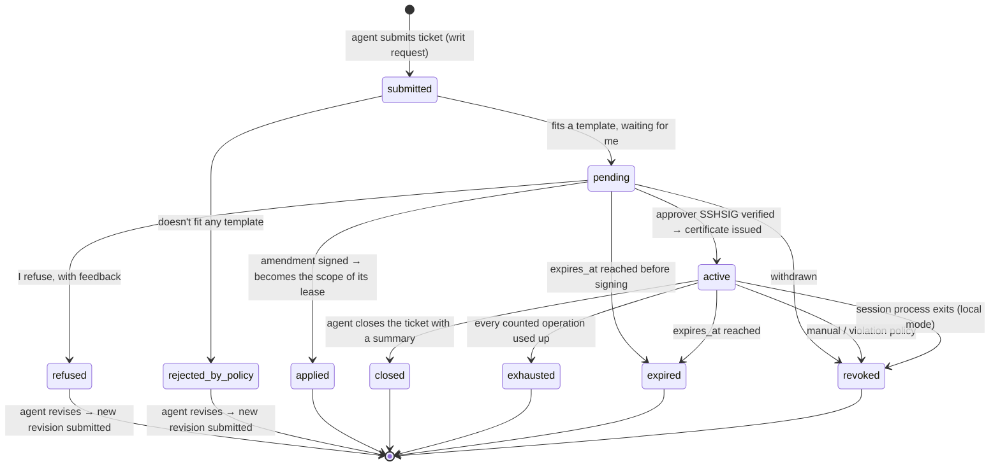

# Lease model

A **ticket** is the agent's request: the task, its plan, and the scope it needs. Once I sign
it with an approver key, it becomes a **lease**: a bounded right for that agent session to use
the daemon. One ticket = one feature or fix.

Three layers, from fixed to per-task:

| Layer | Written by | Changes |
|---|---|---|
| **Repo registry** | Me (admin approval) | Rarely. Hard limits per repo: protected refs, push modes, upstream |
| **Templates** | Me (admin approval) | Rarely. The maximum shape a ticket can take |
| **Ticket** | The agent | Per task. Must fit one template; I sign or refuse it |

The code for this page lives in `crates/writ-core` (types, template fit, narrowing, state
machine) and is enforced by the [policy engine](architecture/policy-and-state.md).

## Repo registry (daemon config, admin-approved)

```yaml
repos:
  omega-code:
    upstream: ssh://git@github.com/user/omega-code.git
    upstream_credential: upstream-github-01   # SSH key on my GitHub account (account-wide access), id in the signer
    protected_refs: ["refs/heads/main", "refs/tags/*"]   # never pushable by any lease
    push_modes: [gateway]                     # default
    ticket_link: trailer                      # trailer | notes | ledger_only
  homelab-scripts:
    upstream: ssh://git@forgejo.home/user/homelab-scripts.git
    upstream_credential: upstream-forgejo-01
    protected_refs: ["refs/heads/main"]
    push_modes: [gateway, proxy]              # proxy: no mirror, refs and commits still checked
  some-https-only-repo:
    upstream: https://git.example.org/user/some-repo.git
    upstream_credential: token-example-01     # token stored in the sealed keystore
    push_modes: [gateway]
  dotfiles:
    upstream: ssh://git@github.com/user/dotfiles.git
    upstream_credential: deploy-dotfiles-01   # deploy key: the forge limits it to this repo
    push_modes: [direct_ssh]                  # agent pushes to GitHub itself
    direct_ssh:
      hosts: [github.com]
      allow_account_wide: false               # refuse if the credential isn't repo-scoped
```

Defaults: `protected_refs: []`, `push_modes: [gateway]`, `ticket_link: trailer`. The
`direct_ssh` section is required with the `direct_ssh` push mode and refused without it.

A lease can only use a push mode that its repo allows. `direct_ssh` with an account-wide key
requires `allow_account_wide: true` in the registry **and** is shown as a warning in the
approval prompt. Push modes are described in [Gateway](architecture/gateway.md#push-modes-per-repo).

Changing the registry is an admin change and needs a signed approval.

## Templates (daemon config, admin-approved)

```yaml
templates:
  feature-branch:
    repos: [omega-code, homelab-scripts]   # a ticket picks from this set
    operations: [fetch, commit_sign, push]
    branches: ["agent/*"]
    push_modes: [gateway, proxy]           # default [gateway]; never direct_ssh here
    force_push: false                      # default false: tickets can't ask for it
    committer_emails: ["user+agent@example.org"]   # required with commit_sign
    signing_key: agent-ed25519-01          # required with commit_sign: the signer key for commits
    max_ttl: 4h
    max_signatures: 50
    max_pushes: 30
    max_ops_per_minute: 20
    max_push_size: 50MB
    paths_check: warn                      # off | warn | deny (default warn)
    require_expected_paths: false
  quick-fix:
    repos: [omega-code, homelab-scripts, dotfiles]
    operations: [fetch, commit_sign, push]
    branches: ["agent/fix-*"]
    committer_emails: ["user+agent@example.org"]
    signing_key: agent-ed25519-01
    max_ttl: 1h
    max_signatures: 10
    max_pushes: 5
    max_ops_per_minute: 10
    max_push_size: 10MB
    paths_check: off                       # quick fixes rarely map to paths
```

Every limit is required, so a template never caps by accident. A template caps every part
of a ticket: repos, operations, branches, force push, committer emails, the signing key and
each limit. `quick-fix` lists `dotfiles`, but `dotfiles` only allows `direct_ssh` and the
template only `gateway` (the default), so a quick-fix ticket can sign for `dotfiles` but not
push to it.

A ticket that doesn't fit any template is rejected by the daemon before it reaches me, with
every reason sent back to the agent. Config errors name the field
(`templates.quick-fix.max_ttl: invalid duration "1 hour"`).

### Patterns and units

- **Branches** (`branches`) are short names: an exact branch (`agent/oauth-login`) or a prefix
  and one trailing `*` (`agent/*`, `agent/fix-*`, `*`), which matches any rest, `/` included.
  Nothing else (no `*` in the middle, no `**`), so whether one pattern is within another is
  exact: `agent/*` covers `agent/fix-*`, which covers `agent/fix-login`.
- **Protected refs** (`protected_refs`) are full refs with the same syntax (`refs/tags/*`),
  matched **ignoring case**: on a case-insensitive file system (APFS, local mode's mirrors)
  `refs/heads/MAIN` is `refs/heads/main`'s own ref file.
- **Committer emails** are printable ASCII only, so a look-alike letter or an invisible
  character can't make one address pass for another on the approver's screen.
- **A caller constraint** names a normalized absolute executable path (no `//`, `.`, `..` or
  trailing `/`, at most 1024 bytes), compared byte for byte; its code identity is bounded.
- **Expected paths** (`expected_paths`) are globs over repository paths: `*` and `?` stay
  inside one directory, `**` crosses them.
- Durations: a number and one unit, `s`, `m`, `h` or `d` (`90s`, `4h`). Sizes: bytes, or a
  number and `KB`, `MB`, `GB` (powers of 10) or `KiB`, `MiB`, `GiB`.

## The ticket the agent writes

`writ request` sends this file; the daemon completes it into the full ticket below.

```yaml
template: feature-branch         # optional: omitted, the only template it fits is chosen
origin_hint: macbook-user       # optional, advisory
caller:                          # optional, set by a harness (see subject.caller below)
scope:
  repos: [omega-code]
  operations: [fetch, commit_sign, push]
  branches: ["agent/oauth-*"]
  force_push: false              # optional
  committer_emails: []           # optional: omitted, the template's
ticket:
  title: "Add OAuth login"
  task: "Add GitHub OAuth login to the web app, behind a feature flag"
  plan: ["Add OAuth client config and callback route", "Store tokens in the existing session store", "Feature flag + tests"]
  expected_paths: ["src/auth/**", "src/routes/oauth*", "tests/auth/**"]
  amends: null                   # the lease this ticket amends
  revises: null                  # the refused ticket this one revises
limits:                          # each optional: omitted, the template's maximum
  ttl: 2h
  max_signatures: 40
  max_pushes: 20
  max_ops_per_minute: 10
  max_push_size: 50MB
on_violation: deny_and_notify    # optional
```

A ticket that fits several templates must name one. Text is bounded so a ticket stays
reviewable (title 200 characters on one line, task 4,000 characters on at most 100 lines,
plan 50 one-line steps of 500, 100 expected paths).

## The complete ticket

What the approver signs, and once signed, the lease's terms. The daemon fills `id`,
`created_at`, `subject.session_key` (from the key sent with the request), the template's
committer emails and signing key, `limits.expires_at = created_at + ttl` (so time spent
waiting for my signature counts), every omitted limit, `revision` and `previous_feedback`
(prefixed `[not signed by an approver]` when the refusal was unsigned, with `decisions: open`).
A ticket asks for at least 5 minutes (`ttl`, and a template's `max_ttl`): a pending ticket
holds one of the approver's waiting slots until it expires. The approver may still narrow a
lease below that when signing. One session key has at most 2 tickets waiting, one source
address (an IPv6 host by its /64) submits at most 10 tickets a minute, and the daemon at
most `max_pending` (20).

```yaml
kind: writ-ticket/1              # the format: an approval can't be read as anything else
id: wrt_01JD8X...
created_at: 2026-10-31T14:02:11Z
template: feature-branch

subject:                         # WHO
  session_key: SHA256:9fq...      # the certificate is issued for this key
  origin_hint: macbook-user     # advisory, shown in the approval prompt
  caller:                        # optional; checked against CallerFacts, missing facts deny
    descends_from:               # local mode: a kernel-resolved process ancestor (or the caller itself)
      executable: /Applications/Omega Code.app/Contents/MacOS/omega
      pid: 4242
      generation: 118            # pidversion: rejects a reused pid
      code_identity: null        # optional: { signing_id, team_id } that must match too

scope:                           # WHAT
  repos: [omega-code]
  operations: [fetch, commit_sign, push]
  branches: ["agent/*"]
  force_push: false
  committer_emails: ["user+agent@…"]
  signing_key: agent-ed25519-01  # from the template; null without commit_sign

ticket:                          # written by the agent, reviewed by me
  title: "Add OAuth login"
  task: "Add GitHub OAuth login to the web app, behind a feature flag"
  plan:                          # short, numbered; the reference for the future LLM check
    - "Add OAuth client config and callback route"
    - "Store tokens in the existing session store"
    - "Feature flag + tests"
  expected_paths: ["src/auth/**", "src/routes/oauth*", "tests/auth/**"]   # see Q24
  amends: null                   # id of the lease this one amends, if any
  revises: wrt_01JD8W...         # id of the refused ticket this one revises, if any
  revision: 2                    # 1, then one more than the ticket it revises
  previous_feedback: "Don't touch billing; keep the session store as is"

limits:                          # HOW MUCH
  expires_at: 2026-10-31T16:02:11Z
  max_signatures: 40
  max_pushes: 20
  max_ops_per_minute: 10
  max_push_size: 50000000        # bytes

on_violation: deny_and_notify    # deny_and_notify | revoke_lease
```

The lease record adds what is not signed: its **state**, the **approval** (approver key
fingerprint, namespace `writ-approval`, the SSHSIG), the **certificate serial** and the
counters. A lease's id is its first ticket's id: the certificate's key id and the `Writ:`
trailer carry it, and it stays when amendments replace the terms.

### Canonical encoding

The approval signs the ticket's **canonical bytes**, defined once in `writ-core`
(`Ticket::canonical_bytes`) and pinned by fixtures (`crates/writ-core/tests/fixtures/`), so
`writ sign` and the daemon always sign and verify the same bytes:

- compact JSON (no whitespace), fields in the order above, `kind` first;
- set-like lists (`repos`, `operations`, `branches`, `committer_emails`, `expected_paths`)
  sorted and deduplicated; `plan` keeps its order;
- absent values as `null`; timestamps as `YYYY-MM-DDTHH:MM:SSZ`; sizes in bytes;
- strings as JSON escapes them (control characters escaped, other characters as UTF-8).

Decoding accepts only bytes that re-encode to exactly themselves: another key order,
whitespace, an unsorted set, an unknown field or another `kind` is refused. Any change to
any field changes the bytes. A new format gets a new `kind`.

## Constraints and how much to trust them

| Constraint | Checked from | Trust |
|---|---|---|
| TTL, counts, rate | Daemon state | 🟢 Strong |
| Repo | Gateway endpoint | 🟢 Strong |
| Destination ref, protected refs | Push commands received by the gateway / proxy | 🟢 Strong (`gateway`, `proxy`) · 🔴 invisible (`direct_ssh`) |
| Force push | Ref update (old → new) | 🟢 Strong (`gateway`, `proxy`) · 🔴 invisible (`direct_ssh`) |
| Pushed commits signed under this lease | Pack vs ledger | 🟢 Strong (`gateway`, `proxy`) · 🔴 invisible (`direct_ssh`) |
| Repo (direct_ssh) | Forge, via a repo-scoped deploy key | 🟢 if deploy key · 🔴 account-wide otherwise |
| Push host (direct_ssh) | `session-bind` host key | 🟢 Strong |
| Committer / author identity | Commit bytes parsed by the daemon | 🟢 Strong |
| Caller = lease holder | Session certificate | 🟡 Strong-ish (bearer; bounded by scope + TTL) |
| Origin host | Source address / hint | 🟠 Advisory |
| Process tree (local mode only) | Kernel peer credentials, via the `CallerAttestor` ([platform](architecture/platform.md)) | 🟢 Strong (extra layer) |
| Files touched vs `expected_paths` | Commit trees, compared by the daemon | 🟢 Strong, if enforced (Q24) |
| Work matches the plan | Signed ticket plan | 🔵 Future [LLM check](backlog/llm-task-conformance.md) (can only tighten) |

## Lifecycle



`submitted` and `rejected_by_policy` are answers to `writ request`, never stored. Every
transition not drawn here is refused (`State::can_become` in `writ-core`).

An **amendment** is a new ticket with `amends: <id>`, from the same session (same session
key), submitted while the lease is active. While pending, the original lease keeps running;
once signed, the amendment becomes `applied` and its terms replace the lease's: the lease
keeps its id, certificate and counters (its `max_signatures` is the new total, not more on
top). If the lease ended before the amendment is signed, the amendment can't be applied.

A lease is **exhausted** when every operation it allows is used up: signatures with
`commit_sign`, pushes with `push`. `fetch` has no count, so a lease that allows it never
becomes exhausted (it ends by expiry, close or revocation); its signing and pushing still
stop at their limits. This keeps exhaustion monotone: narrowing away an operation never
revives a used-up lease.

## Rules

- A request must match **exactly one** lease (certificate key id, serial and session key);
  none or more than one means deny. The lease must then be active and not past `expires_at`.
- A lease is used only while it still fits its template **under the current config**: if an
  admin change tightens or removes the template or a repo, its leases are denied (fail
  closed) until amended.
- Leases are **never extended silently**. Extending is a new signed approval.
- **Every ticket must fit a template** (Q14). An approval can't exceed a template; new
  templates are admin changes.
- The ticket's text (title, task, plan) is written by the agent: shown to me as-is, never
  trusted by the policy engine. Only the structured scope is enforced.
- Refusals carry my feedback back to the agent; the next revision shows it alongside the new
  ticket. A revision comes from the **same session** as the refused ticket (its session key):
  from any other, it is rejected and the feedback stays with the session it was written for.
  `writ request` reuses that session's key for a revision, as it does for an amendment.
- I can **narrow** a ticket while signing it (shorter TTL, fewer repos/branches/ops, lower
  limits). The daemon accepts the signature only if every field of the signed ticket is the
  same as submitted or narrower, then returns the final lease to the agent. Narrower means:
  fewer repos, operations or committer emails; branches each within a submitted pattern;
  force push off; each limit and `expires_at` lower or equal; `on_violation` as strict or
  stricter; `expected_paths` a non-empty subset (emptying it would turn the path check off),
  or any if none were submitted. Id, time, template, subject, signing key and text can't
  change.
- **Force push** covers non-fast-forward updates and deleting a branch. Creating a branch is
  never one.
- Only branches (`refs/heads/…`) can be pushed; any other ref is denied even if no pattern
  protects it.
- Signing names the repo the commit is for; the ledger records it, and a push only accepts
  commits signed under the same lease **for the same repo**.
- `ticket_link` (per repo): with `trailer`, every commit must carry exactly one `Writ: <id>`
  matching the lease, or signing is refused. The trailer must be in the message **before** signing; the
  daemon never rewrites commits. With `notes`, the daemon attaches a note under
  `refs/notes/writ` and pushes it upstream. With `ledger_only`, the link exists only in the
  daemon.
- `paths_check` (per template): compares files touched by each commit with `expected_paths`.
  `warn` notifies and flags the activity report; `deny` refuses to sign, also when the
  touched paths can't be computed.
- `protected_refs` from the registry always win over any lease. With account-wide upstream
  keys, this registry is the **only** per-repo boundary.
- Active leases are persisted (SQLite) and reloaded after unsealing; certificates stay valid
  until they expire.
