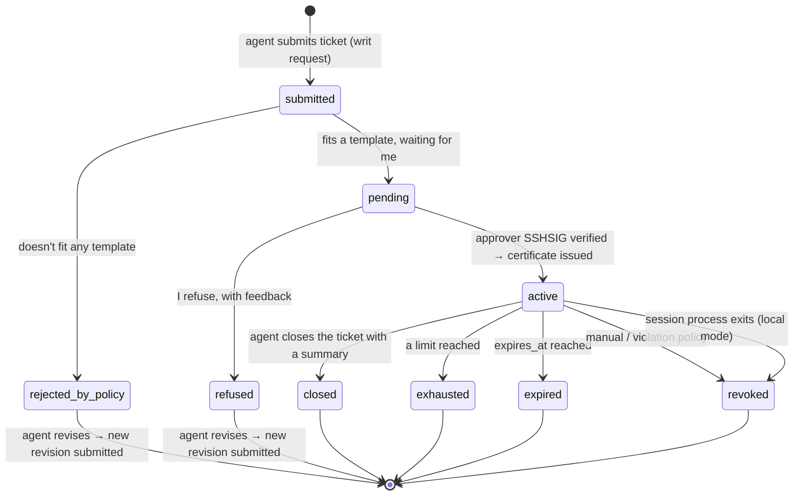

# Lease model

A **ticket** is the agent's request: the task, its plan, and the scope it needs. Once I sign
it with an approver key, it becomes a **lease**: a bounded right for that agent session to use
the daemon. One ticket = one feature or fix.

Three layers, from fixed to per-task:

| Layer | Written by | Changes |
|---|---|---|
| **Repo registry** | Me (admin approval) | Rarely. Hard limits per repo: protected refs, push modes, upstream |
| **Templates** | Me (admin approval) | Rarely. The maximum shape a ticket can take |
| **Ticket** | The agent | Per task. Must fit one template; I sign or refuse it |

The code for this page lives in `crates/writ-core` (types, template fit, narrowing, state
machine) and is enforced by the [policy engine](architecture/policy-and-state.md).

## Repo registry (daemon config, admin-approved)

```yaml
repos:
  omega-code:
    upstream: ssh://git@github.com/user/omega-code.git
    upstream_credential: upstream-github-01   # SSH key on my GitHub account (account-wide access), id in the signer
    protected_refs: ["refs/heads/main", "refs/tags/*"]   # never pushable by any lease
    push_modes: [gateway]                     # default
    ticket_link: trailer                      # trailer | notes | ledger_only
  homelab-scripts:
    upstream: ssh://git@forgejo.home/user/homelab-scripts.git
    upstream_credential: upstream-forgejo-01
    protected_refs: ["refs/heads/main"]
    push_modes: [gateway, proxy]              # proxy: no mirror, refs and commits still checked
  some-https-only-repo:
    upstream: https://git.example.org/user/some-repo.git
    upstream_credential: token-example-01     # token stored in the sealed keystore
    push_modes: [gateway]
  dotfiles:
    upstream: ssh://git@github.com/user/dotfiles.git
    upstream_credential: deploy-dotfiles-01   # deploy key: the forge limits it to this repo
    push_modes: [direct_ssh]                  # agent pushes to GitHub itself
    direct_ssh:
      hosts: [github.com]
      allow_account_wide: false               # refuse if the credential isn't repo-scoped
```

A lease can only use a push mode that its repo allows. `direct_ssh` with an account-wide key
requires `allow_account_wide: true` in the registry **and** is shown as a warning in the
approval prompt. Push modes are described in [Gateway](architecture/gateway.md#push-modes-per-repo).

Changing the registry is an admin change and needs a signed approval.

## Templates (daemon config, admin-approved)

```yaml
templates:
  feature-branch:
    repos: [omega-code, homelab-scripts]   # a ticket picks from this set
    operations: [fetch, commit_sign, push]
    branches: ["agent/*"]
    push_modes: [gateway, proxy]           # never direct_ssh
    max_ttl: 4h
    max_signatures: 50
    max_pushes: 30
    paths_check: warn                      # off | warn | deny
    require_expected_paths: false
  quick-fix:
    repos: [omega-code, homelab-scripts, dotfiles]
    operations: [fetch, commit_sign, push]
    branches: ["agent/fix-*"]
    max_ttl: 1h
    max_signatures: 10
    paths_check: off                       # quick fixes rarely map to paths
```

A ticket that doesn't fit any template is rejected by the daemon before it reaches me, with
the reason sent back to the agent.

## Ticket / lease schema (draft)

```yaml
id: wrt_01JD8X...
created_at: 2026-10-31T14:02:11Z
state: active                    # pending | active | exhausted | expired | revoked
template: feature-branch

approval:
  approver: SHA256:Kp3…            # fingerprint of an approver key (e.g. Secretive "writ-approver")
  namespace: writ-approval
  sshsig: <SSHSIG over the canonical lease content>

subject:                         # WHO
  session_key: SHA256:9fq...
  cert_serial: 1842
  origin_hint: macbook-user     # advisory, shown in the approval prompt
  caller:                        # optional; checked against CallerFacts, missing facts deny
    descends_from:               # local mode: a kernel-resolved process ancestor
      executable: /Applications/Omega Code.app/Contents/MacOS/omega
      pid: 4242
      generation: 118            # pidversion: rejects a reused pid

scope:                           # WHAT
  repos: [omega-code]
  operations: [fetch, commit_sign, push]
  branches: ["agent/*"]
  force_push: false
  committer_emails: ["user+agent@…"]
  signing_key: agent-ed25519-01

ticket:                          # written by the agent, reviewed by me
  title: "Add OAuth login"
  task: "Add GitHub OAuth login to the web app, behind a feature flag"
  plan:                          # short, numbered; the reference for the future LLM check
    - "Add OAuth client config and callback route"
    - "Store tokens in the existing session store"
    - "Feature flag + tests"
  expected_paths: ["src/auth/**", "src/routes/oauth*", "tests/auth/**"]   # see Q24
  amends: null                   # id of the ticket this one extends, if any
  revision: 2                    # bumped each time the agent resubmits after a refusal
  previous_feedback: "Don't touch billing; keep the session store as is"

limits:                          # HOW MUCH
  expires_at: 2026-10-31T16:02:11Z
  max_signatures: 40
  max_pushes: 20
  max_ops_per_minute: 10
  max_push_size: 50MB

on_violation: deny_and_notify    # deny_and_notify | revoke_lease
```

The approval signs the **canonical** encoding of this content: one deterministic byte form,
defined once in `writ-core` and pinned by fixtures, so `writ sign` and the daemon always sign
and verify the same bytes.

## Constraints and how much to trust them

| Constraint | Checked from | Trust |
|---|---|---|
| TTL, counts, rate | Daemon state | 🟢 Strong |
| Repo | Gateway endpoint | 🟢 Strong |
| Destination ref, protected refs | Push commands received by the gateway / proxy | 🟢 Strong (`gateway`, `proxy`) · 🔴 invisible (`direct_ssh`) |
| Force push | Ref update (old → new) | 🟢 Strong (`gateway`, `proxy`) · 🔴 invisible (`direct_ssh`) |
| Pushed commits signed under this lease | Pack vs ledger | 🟢 Strong (`gateway`, `proxy`) · 🔴 invisible (`direct_ssh`) |
| Repo (direct_ssh) | Forge, via a repo-scoped deploy key | 🟢 if deploy key · 🔴 account-wide otherwise |
| Push host (direct_ssh) | `session-bind` host key | 🟢 Strong |
| Committer / author identity | Commit bytes parsed by the daemon | 🟢 Strong |
| Caller = lease holder | Session certificate | 🟡 Strong-ish (bearer; bounded by scope + TTL) |
| Origin host | Source address / hint | 🟠 Advisory |
| Process tree (local mode only) | Kernel peer credentials, via the `CallerAttestor` ([platform](architecture/platform.md)) | 🟢 Strong (extra layer) |
| Files touched vs `expected_paths` | Commit trees, compared by the daemon | 🟢 Strong, if enforced (Q24) |
| Work matches the plan | Signed ticket plan | 🔵 Future [LLM check](backlog/llm-task-conformance.md) (can only tighten) |

## Lifecycle



An **amendment** is a new ticket with `amends: <id>`. While pending, the original lease keeps
running; once signed, it replaces the original's scope.

## Rules

- A request must match **exactly one** active lease; ambiguity means deny.
- Leases are **never extended silently**. Extending is a new signed approval.
- **Every ticket must fit a template** (Q14). An approval can't exceed a template; new
  templates are admin changes.
- The ticket's text (title, task, plan) is written by the agent: shown to me as-is, never
  trusted by the policy engine. Only the structured scope is enforced.
- Refusals carry my feedback back to the agent; the next revision shows it alongside the new
  ticket.
- I can **narrow** a ticket while signing it (shorter TTL, fewer repos/branches/ops, lower
  limits). The daemon accepts the signature only if the signed ticket is a strict subset of
  the submitted one, then returns the final lease to the agent.
- `ticket_link` (per repo): with `trailer`, every commit must carry `Writ: <id>` matching the
  lease, or signing is refused. The trailer must be in the message **before** signing; the
  daemon never rewrites commits. With `notes`, the daemon attaches a note under
  `refs/notes/writ` and pushes it upstream. With `ledger_only`, the link exists only in the
  daemon.
- `paths_check` (per template): compares files touched by each commit with `expected_paths`.
  `warn` notifies and flags the activity report; `deny` refuses to sign.
- `protected_refs` from the registry always win over any lease. With account-wide upstream
  keys, this registry is the **only** per-repo boundary.
- Active leases are persisted (SQLite) and reloaded after unsealing; certificates stay valid
  until they expire.
